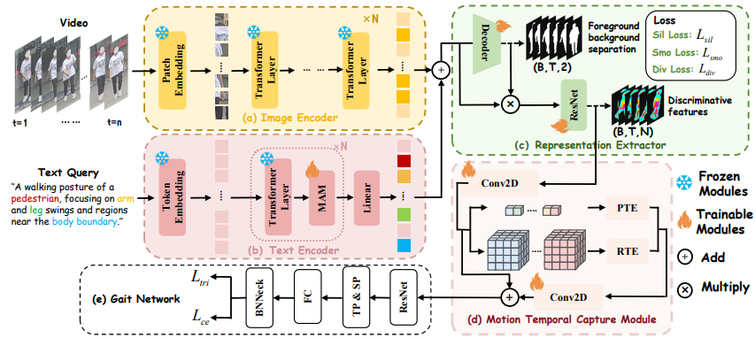

<div align="center">

# 🍬 LMGait(AAAI2026)
###  Language-Guided and Motion-Aware Gait Representation for Generalizable Recognition

[](https://arxiv.org/pdf/2601.11931)
[](LICENSE)
[](https://dingwu1021.github.io/LMGait/)




*Pipeline of the proposed LMGait, it consists of five components. Specifically, the video input is processed through the frozen Dinov2 model for feature extraction. The text query guides the network to focus on gait-relevant regions, and it is aligned with the image feature space through the frozen CLIP text encoder and the fine-tuned MAM module. The Representation Extractor generates diverse features, while the Motion Temporal Capture Module captures posture changes during walking. Finally, the extracted features are input into the Gait Network for recognition.*

</div>

## 📋 Table of Contents

- [🧭 Overview](#-overview)
- [📊 Performance Results](#-performance-results)
- [🚀 Quick Start](#-quick-start)
- [🤝 Acknowledgements](#-acknowledgements)
- [📄 Citation](#-citation)

---

## 🧭 Overview

Gait recognition enables remote human identification, but existing methods often use complex architectures to pool image features into sequence-level representations. Such designs can overfit to static noise (e.g., clothing) and miss dynamic motion regions (e.g., arms and legs), making recognition brittle under intra-class variations.

We present *LMGait, a Language-guided and Motion-aware* framework that introduces natural language descriptions as explicit semantic priors for gait recognition. We leverage designed gait-related language cues to highlight key motion patterns, propose a Motion Awareness Module (MAM) to refine language features for better cross-modal alignment, and introduce a Motion Temporal Capture Module (MTCM) to enhance discriminative gait representations and motion tracking.

> 🏆 **Achievement:** our method achieves consistent and stable performance gains across multiple datasets.

---

## 📊 Performance Results

### 🧍‍♂️ Results on CCPG
| Method            | CL       | UP       | DN       | BG       | Mean     |
| ----------------- | -------- | -------- | -------- | -------- | -------- |
| GaitGraph2        | 5.0      | 5.3      | 5.8      | 6.2      | 5.6      |
| Gait-TR           | 15.7     | 18.3     | 18.5     | 17.5     | 17.5     |
| GPGait            | 54.8     | 65.6     | 71.6     | 65.4     | 64.2     |
| SkeletonGait      | 40.4     | 48.5     | 53.0     | 61.7     | 50.9     |
| GaitSet           | 60.2     | 65.2     | 65.1     | 68.5     | 64.8     |
| GaitBase          | 71.6     | 75.0     | 76.8     | 78.6     | 75.5     |
| DeepGaitV2        | 78.6     | 84.8     | 80.7     | 89.2     | 83.3     |
| SkeletonGait++    | 79.1     | 83.9     | 81.7     | 89.9     | 83.7     |
| MultiGait++       | 83.9     | 89.0     | 86.0     | 91.5     | 87.6     |
| BigGait           | 82.6     | 85.9     | 87.1     | 93.1     | 87.2     |
| **LMGait (Ours)** | **84.8** | **87.0** | **88.5** | **93.6** | **88.5** |


> **Key Observation:**  
> LMGait achieves the best overall performance on CCPG, with consistent improvements under DN and BG, indicating strong robustness to clothing and background variations.

### 🧍‍♀️ Results on SUSTech1K

| Method            | NM       | CL       | UF       | NT       | Mean     |
| ----------------- | -------- | -------- | -------- | -------- | -------- |
| GaitGraph2        | 22.2     | 6.8      | 19.2     | 16.4     | 18.6     |
| Gait-TR           | 33.3     | 21.0     | 34.6     | 23.5     | 30.8     |
| GPGait            | 44.0     | 24.3     | 47.0     | 31.8     | 41.4     |
| SkeletonGait      | 55.0     | 24.7     | 52.0     | 43.9     | 50.1     |
| GaitSet           | 69.1     | 61.0     | 23.0     | 65.0     | 18.6     |
| GaitBase          | 81.5     | 49.6     | 76.7     | 25.9     | 76.1     |
| DeepGaitV2        | 86.5     | 49.2     | 81.9     | 28.0     | 80.9     |
| SkeletonGait++    | 85.1     | 46.6     | 82.5     | 47.5     | 81.3     |
| MultiGait++       | 92.0     | 50.4     | 89.1     | 45.1     | 87.4     |
| BigGait           | 96.1     | 73.3     | 93.2     | 85.3     | 96.2     |
| **LMGait (Ours)** | **96.4** | **79.8** | **93.9** | **87.0** | **97.1** |


> **Key Observation:**  
> On SUSTech1K, LMGait delivers state-of-the-art performance across all evaluation settings, with particularly strong gains under CL and NT, demonstrating excellent generalization in real-world scenarios.

---

### ✨ Key Features

</details>

<details>
<summary><b>🎥 Multimodal Gait Representation with Visual–Language Priors</b></summary>

We introduce a multimodal gait recognition pipeline that jointly leverages visual observations and language-based semantic priors. By injecting domain-specific motion descriptions into visual feature learning, the model is guided to attend to gait-discriminative body regions, improving robustness under cluttered backgrounds and occlusions.

</details>

<details>
<summary><b>🧠 Motion-Aware Language Modulation</b></summary>

Instead of treating language features as static prompts, we propose a Motion Awareness Module (MAM) that adaptively refines textual representations based on gait dynamics. This enables the language branch to emphasize motion-relevant semantics while suppressing distractive cues, softly modulating visual features without introducing rigid constraints.

</details>

<details>
<summary><b>⏱️ Language-Guided Temporal Motion Modeling</b></summary>

To capture the continuous nature of human walking, we design a Motion Temporal Capture Module that jointly models pixel-level and region-level motion patterns. Benefiting from language-guided visual representations, the temporal module aggregates motion trajectories more effectively, avoiding noise accumulation and enabling stable, discriminative gait modeling over time.

</details>


---

## 🚀 Quick Start
#### Step 1: 🛠️ Environment Setup
Same as [OpenGait](https://github.com/ShiqiYu/OpenGait).
```bash
conda create -n lmgait python=3.10
conda activate lmgait
pip install -r requirements.txt

```


#### Step 2: ⚙️ Configuration
To start training, update the configuration in `train.sh` by modifying the relevant arguments.

Configure your training setup in `configs/LMGait/LMGait_SUSTECH.yaml` and `opengait/modeling/text_configs.py`:

CCPG and CASIAB* are trained with the same parameter configuration.
```bash
# Dataset paths
DATASET_ROOT="dataset/SUSTech1K-RGB-pkl"              # Preprocessed dataset root
DATASET_PARTITION="datasets/SUSTech1K/SUSTech1K.json" # Train / Val / Test split
# NOTE: Use datasets/pretreatment_rgb.py for data preprocessing

# Pretrained visual backbones
PRETRAINED_DINOV2="pretrained_model/dinov2_vits14_pretrain.pth"

PRETRAINED_MASK_BRANCH="pretrained_model/MaskBranch_vits14.pt"

# Language model components
CLIP_VIT_B16_PATH="ViT-B-16.pt"                        # CLIP ViT-B/16 weights
BPE_SIMPLE_VOCAB_PATH="bpe_simple_vocab_16e6.txt.gz"   # CLIP BPE vocabulary
```
Please download the RGB-pkl files for the CCPG and SUSTech1K datasets, and preprocess them using the standard dataset preprocessing pipeline provided by OpenGait ([see the OpenGait repository for details](https://github.com/ShiqiYu/OpenGait)).

Optionally, the pretrained mask from [BigGait](https://drive.google.com/drive/folders/1zrWPUsrbCpwxoLgfom3d2irgxkBqtXqc?usp=sharing) can be used to initialize the mask branch.

Download the [CLIP ViT-B/16 encoder model](https://huggingface.co/openai/clip-vit-base-patch16/tree/main) and its [vocabulary file](https://github.com/openai/CLIP/blob/main/clip/bpe_simple_vocab_16e6.txt.gz).

#### Step 3: 🚀 Start Training

Launch the training process with customizable hyperparameters:

```bash
bash train.sh
```

## 🤝 Acknowledgements

> 📢 **Acknowledgment:** Our codebase is built upon the [Biggait](https://github.com/ShiqiYu/OpenGait/blob/master/opengait/modeling/models/BigGait.py) framework, and we thank the authors for their valuable contributions to the community！

---

## 📄 Citation

If you find our paper is useful in your research, please consider citing our paper:

```bibtex
@misc{wu2026languageguidedmotionawaregaitrepresentation,
      title={Language-Guided and Motion-Aware Gait Representation for Generalizable Recognition}, 
      author={Zhengxian Wu and Chuanrui Zhang and Shenao Jiang and Hangrui Xu and Zirui Liao and Luyuan Zhang and Huaqiu Li and Peng Jiao and Haoqian Wang},
      year={2026},
      eprint={2601.11931},
      archivePrefix={arXiv},
      primaryClass={cs.CV},
      url={https://arxiv.org/abs/2601.11931}, 
}
```

---

<div align="center">

**🌟 Star this repo if you find it helpful!**


</div>